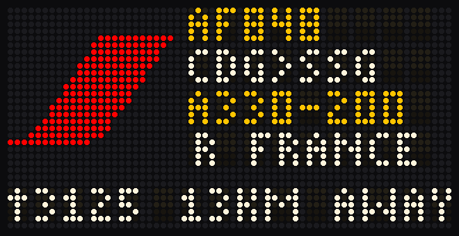

# Plane Over Me

A small LED display for your living room that shows the plane flying over your home right now: the flight number, where it's going, the aircraft type, the airline, how high it is and how far away.



It's built for a Raspberry Pi with a 64×32 LED panel. Until you have the hardware, you can run it on your computer: an LED simulator opens in your browser and shows real planes over your town.

## What it does

- Picks the most interesting plane near you and shows it, then moves on to the next one.
- Shows the flight number, route (CDG>JFK), aircraft type, airline logo and name, altitude and distance.
- Big planes you choose (A380, 747, A350...) jump the queue and can be further away.
- Emergency squawks always come first.
- Uses free, open flight data. No account or API key needed.

## Try it on your computer

You need Python 3.9 or newer. Most Macs and Linux computers already have it. On Windows, get it from [python.org](https://www.python.org/downloads/) and tick "Add Python to PATH" when installing.

1. **Download the project.** Click the green **Code** button at the top of this page, then **Download ZIP**. Unzip it anywhere.
2. **Start it.**
   - **Mac:** double-click `start.command`. The first time, macOS may say it's from an unidentified developer: right-click the file, choose **Open**, then **Open** again.
   - **Windows:** double-click `start.bat`.
   - **Linux:** run `./start.sh` in the folder.
3. **Tell it where you live.** The first start asks for your town or postcode, then downloads aircraft data and airline logos. This takes about a minute, once.
4. **Watch.** Your browser opens the LED simulator at `http://localhost:8888`.

To stop it, close the window that opened, or press `Ctrl+C` in it. To start again, repeat step 2. It remembers your location.

**No planes showing?** It only shows planes that are close and fairly low (by default within 18 km and under 25,000 ft). Away from airports, quiet spells are normal. You can widen the limits, see below.

**Want to see it working straight away?** Start it in demo mode with a recording of real traffic over Paris: on Mac or Linux, run `./start.sh --sample --sample-file samples/recording.jsonl` in the folder.

## Change the settings

All settings are in `settings.toml`, with a note on each one. To change one, copy it into `settings.local.toml` (created on first start) and edit it there. That file is yours: updates to the project never touch it.

The ones people change most:

| Setting | What it does | Default |
|---|---|---|
| `[rules] max_distance_km` | How far away a plane can be | `18` |
| `[rules] max_altitude_ft` | Ignore planes higher than this | `25000` |
| `[rules] airlines_only` | Hide private planes and helicopters | `true` |
| `[rules.watchlist] types` | Aircraft types that always get shown | A380, 747, A350... |
| `[display] altitude_unit` | `"ft"` or `"m"` | `"ft"` |
| `[display] speed_unit` | `"kmh"` or `"kt"` | `"kmh"` |
| `[display] clock_24h` | 24-hour clock when no plane is shown | `true` |

To change your location, run `python -m planeoverme setup` (or delete `settings.local.toml` and start again).

## Build the real thing

**Coming soon.** The software is done and tested in the simulator. The Raspberry Pi version is the next step, see [docs/pi-setup.md](docs/pi-setup.md) for the plan.

Parts:

| Part | Notes |
|---|---|
| Raspberry Pi 3 Model B or Pi 4 | Any model with Wi-Fi and the 40-pin header |
| 64×32 RGB LED matrix, 4 mm pitch (P4), HUB75 | About 26 × 13 cm. Tested with a Waveshare panel |
| Adafruit RGB Matrix Bonnet (product 3211) | Connects the panel to the Pi and powers both |
| 5 V 4 A power supply, barrel plug | Plugs into the bonnet |
| microSD card, 16 GB or more | For Raspberry Pi OS |
| BH1750 light sensor (optional) | Dims the panel when the room gets dark |

## Roadmap

| Status | Step |
|---|---|
| Done | Live flight data, picking rules, screen layouts, airline logos |
| Done | Browser simulator, one-step setup on Mac, Windows and Linux |
| Next | Run on the Raspberry Pi and LED panel, one-command install |
| Next | Automatic brightness with the light sensor |
| Later | Settings page in the browser, so nobody needs to edit files |
| Later | A case with a smoked front |

## Commands

For the curious. Run them inside the project folder with `.venv/bin/python -m planeoverme <command>` (on Windows: `.venv\Scripts\python -m planeoverme <command>`).

| Command | What it does |
|---|---|
| `start` | Set up if needed, then run and open the browser |
| `run` | Run the display without opening the browser |
| `run --sample --sample-file samples/recording.jsonl` | Replay recorded traffic, works offline |
| `setup` | Choose your location again |
| `update-data` | Download the latest aircraft data and logos |
| `nearby` | List the planes around you in the terminal |
| `record --minutes 10` | Record live traffic to replay later |
| `logos` | Rebuild the LED logo images, e.g. after editing `data/badges.toml` |

## How it works

```
planeoverme/     the app (Python)
  sources.py     where planes come from (adsb.lol, or a recording)
  flight.py      airline, aircraft type and route for each plane
  rules.py       which planes qualify, and in what order
  tracker.py     which plane is on screen, and for how long
  render/        draws the 64×32 frames
  display/       sends frames to the browser simulator (LED panel next)
  firstrun.py    location setup and data downloads on first start
data/            aircraft names and hand-drawn 7×7 airline badges
samples/         recorded traffic for offline demos and tests
tests/           automated tests (python -m pytest)
```

The free adsb.lol service allows 500 requests a day. The app spreads them over the day (none during quiet hours at night) and estimates how planes move in between.

## Credits

- Live flight data: [adsb.lol](https://adsb.lol), under the [ODbL](https://opendatacommons.org/licenses/odbl/).
- Aircraft, airline, airport and route data: [VRS standing-data](https://github.com/vradarserver/standing-data), CC0. Downloaded on first start.
- Airline logos: collected by [Jxck-S/airline-logos](https://github.com/Jxck-S/airline-logos). Downloaded on first start, not included in this project. All logos are trademarks of their airlines and are only used to identify them.
- Place search on first start: [OpenStreetMap Nominatim](https://nominatim.openstreetmap.org).

## Licence

The code is under the [MIT licence](LICENSE): use it, change it, share it.
